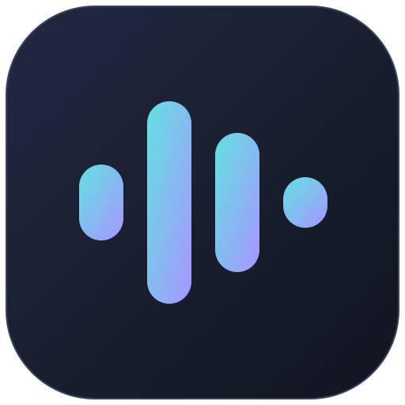

<p align="center"></p>

# MiniBar

**Sua mídia, sempre por perto.**

Um widget de mídia para Windows 10 e 11 com controles junto à barra de tarefas, letras sincronizadas, temas e informações de bateria. O MiniBar controla a sessão de mídia que os aplicativos disponibilizam ao Windows, incluindo Spotify e navegadores compatíveis.

**Versão atual: 1.5.3.** Anteriormente chamado **Meu Player**.

## Baixar e executar

1. Abra a [release mais recente](https://github.com/Fernando-Almeida582/MiniBar/releases/latest).
2. Baixe `MiniBar-1.5.3-Windows-x64.zip` e extraia **todo** o conteúdo em uma pasta.
3. Instale o [.NET Desktop Runtime 10 x64](https://dotnet.microsoft.com/en-us/download/dotnet/10.0), caso ainda não esteja instalado.
4. Execute **MiniBar.exe**. Clique com o botão direito no widget ou no ícone da bandeja para abrir as opções.

O pacote é para Windows x64 e depende do runtime instalado no sistema. O executável não tem assinatura digital.

## Atualizar do Meu Player

Encerre a versão anterior pelo menu da bandeja antes de abrir o MiniBar. A identificação interna de instância única foi preservada para evitar duas versões rodando juntas.

As preferências continuam em `%LocalAppData%\MeuPlayer\preferencias.json` e as letras locais em `%LocalAppData%\MeuPlayer\Letras`. Esses caminhos históricos foram mantidos para preservar seus dados.

Se **Iniciar com o Windows** estava ativo, desative a opção na versão antiga e ative novamente pelo MiniBar na pasta definitiva. O MiniBar reconhece a entrada antiga; ao desativar a opção, remove as entradas antigas e novas do próprio aplicativo. Ao ativá-la, registra `MiniBar.exe`.

O repositório agora é `Fernando-Almeida582/MiniBar`. O nome do produto, o executável e a identidade visual agora são **MiniBar**; as releases antigas continuam disponíveis.

## Recursos

- **Controles de mídia:** anterior, reproduzir/pausar e próxima, conforme as capacidades da sessão ativa.
- **Capa, faixa e artista**, quando fornecidos pelo aplicativo de origem.
- **Seleção de minutagem:** passe o mouse sobre a capa ou o título para abrir a barra de progresso; clique ou arraste para escolher a posição, se a sessão permitir.
- **Abrir a origem:** clique na capa ou no título para trazer o aplicativo ou uma aba compatível à frente.
- **Letras no título:** opção **Exibir → Exibir letra da faixa**. Sem letra sincronizada disponível, mantém o título.
- **Onze temas**, incluindo o **Adaptativo**, baseado nas cores da capa.
- **Bateria Bluetooth e USB/2,4 GHz compatível**, compartilhada entre os monitores.
- **Modo fixo à esquerda ou à direita**, modo flutuante horizontal/vertical e suporte a múltiplos monitores.
- **Ocultar em tela cheia** e **Jogar para trás (fixo)**.
- **Ícone Pulso estático**, com versões para a bandeja clara e escura. Não há pulsação de áudio nesta edição.

## Posição, espaço e múltiplos monitores

O modo fixo é uma janela independente posicionada junto à barra de tarefas. Ele consulta o espaço ocupado pelos elementos acessíveis da barra em segundo plano, a cada três segundos. Quando não há espaço suficiente, recua para a área logo acima da barra. Essa medição é uma estimativa e depende da interface acessível do Windows.

As letras podem expandir o widget conforme a largura necessária e o espaço disponível. A maior largura usada permanece durante a faixa para evitar saltos a cada verso. Se não couber, o texto mantém as reticências. Cada monitor respeita seu próprio espaço.

No modo Estender, há uma cópia por monitor, com mídia, baterias, preferências e consultas compartilhadas. Se um monitor não exibir a barra de tarefas, o widget fica próximo à borda inferior. No modo solto, há uma única janela: arraste pelo fundo, pela capa ou pelo título. O menu **Posição** permite escolher o layout vertical e a opção de ficar atrás das janelas no modo solto.

## Tela cheia e ordem das janelas

**Exibir → Ocultar em tela cheia (fixo)** vem ativado, inclusive na migração das preferências antigas. A detecção considera as bordas da janela e as bordas visíveis do DWM, com tolerância a pequenas diferenças de pixels e janelas que ultrapassam o monitor. Cada cópia é ocultada quando a janela em primeiro plano cobre seu monitor. Ao sair da tela cheia, o temporizador recupera a visibilidade. Iniciar e Busca são excluídos dessa detecção.

Em **Posição → Jogar para trás (fixo)**, o MiniBar deixa de ficar sempre no topo e é colocado atrás da janela atual, sem tomar o foco. Nesse modo permanece fixo logo acima da barra, para não ser coberto pela própria barra de tarefas. Se uma janela o cobrir, acesse o menu pelo ícone da bandeja e desmarque a opção para restaurar o encaixe normal.

Os textos de ajuda e o seletor de minutagem são mantidos à frente do widget, sem ativar a janela. As dicas são fechadas quando o player é ocultado por tela cheia.

## Letras e abertura da mídia

Com **Exibir letra da faixa** habilitado, o MiniBar consulta o LRCLIB por HTTPS usando título, artista e, quando disponíveis, álbum e duração. Letras locais `.lrc` associadas em versões anteriores têm prioridade. O trecho sincronizado substitui o título, mantendo artista, capa, controles, clique de abertura e seleção de minutagem. O temporizador das linhas funciona quando há letra sincronizada e a mídia está tocando.

A abertura de abas usa os nomes acessíveis expostos pelo navegador e só é consultada ao clicar. Durante anúncios do YouTube, tenta identificar a aba pelo indicador de reprodução de áudio. Quando não consegue identificar uma aba com segurança, apenas traz o navegador à frente. Não instala extensão nem lê o histórico ou o perfil do navegador.

## Bateria dos dispositivos

A leitura Bluetooth acompanha os eventos do Windows. A consulta USB é feita em segundo plano a cada 30 segundos enquanto a exibição de baterias está ativa.

Receptores de 2,4 GHz são suportados quando o Windows fornece a porcentagem ou a coleção HID expõe um campo padrão de bateria em um relatório Feature. A leitura é somente leitura. Protocolos proprietários e aparelhos que só fornecem carga por relatórios de entrada podem não aparecer.

Sem uma leitura de dispositivo compatível, aparece o símbolo de Bluetooth com **x vermelho** e a legenda **Nenhum dispositivo conectado**. Esse aviso se refere aos aparelhos que o MiniBar consegue monitorar; não é um inventário de todos os dispositivos conectados ao computador. Se a consulta estiver indisponível, aparece **Bateria indisponível**. Passe o mouse para ler a explicação. Um traço sob um aparelho identificado significa que a porcentagem ainda não foi disponibilizada.

## Segurança e dados

O aplicativo usa as permissões da conta atual. Não inclui telemetria, atualizador, gravação de áudio, acesso ao microfone ou hooks globais. A consulta opcional de letras envia ao LRCLIB os dados da faixa usados na busca; não acessa contas, credenciais ou cookies do Spotify ou do YouTube.

**Iniciar com o Windows** só grava a entrada de inicialização da conta atual quando escolhido no menu. As preferências são salvas quando você altera uma opção. O alinhamento da barra de tarefas é consultado no Registro em modo somente leitura.

## Compilar

O projeto utiliza **C#, WPF, .NET 10 e as APIs do SDK do Windows**, sem pacotes de terceiros. Instale o .NET 10 SDK para Windows e execute na pasta do fonte:

```powershell
dotnet publish .\MeuPlayer.csproj -c Release --self-contained false -o .\publicacao
```

O arquivo do projeto e o namespace ainda usam o identificador histórico `MeuPlayer`; os metadados e o assembly são **MiniBar**. A pasta `publicacao` contém `MiniBar.exe` e seus arquivos de suporte; distribua-os juntos.

O layout principal fica em `PlayerWindow.xaml`. Os ícones de aplicativo e bandeja estão em `Resources`. A leitura de bateria fica em `PeripheralBattery.cs` e `UsbHidBattery.cs`. A ordem dos textos de ajuda é tratada em `PlayerWindow.ToolTips.cs`.

## Validação e limites

A versão 1.5.3 foi compilada em Release. Passaram 37 verificações locais de identidade e recursos, migração de preferências, geometria de tela cheia e ordem Z com janelas nativas de teste, incluindo reposicionamento de popups sem tomar o foco.

Essas verificações não equivalem a testar todos os jogos, sistemas de anti-cheat, navegadores ou configurações de monitores. Tela cheia exclusiva e os diferentes drivers Bluetooth/HID ainda dependem de validação em uso. O aviso de conexão reflete as leituras de bateria reconhecidas pelo aplicativo.
